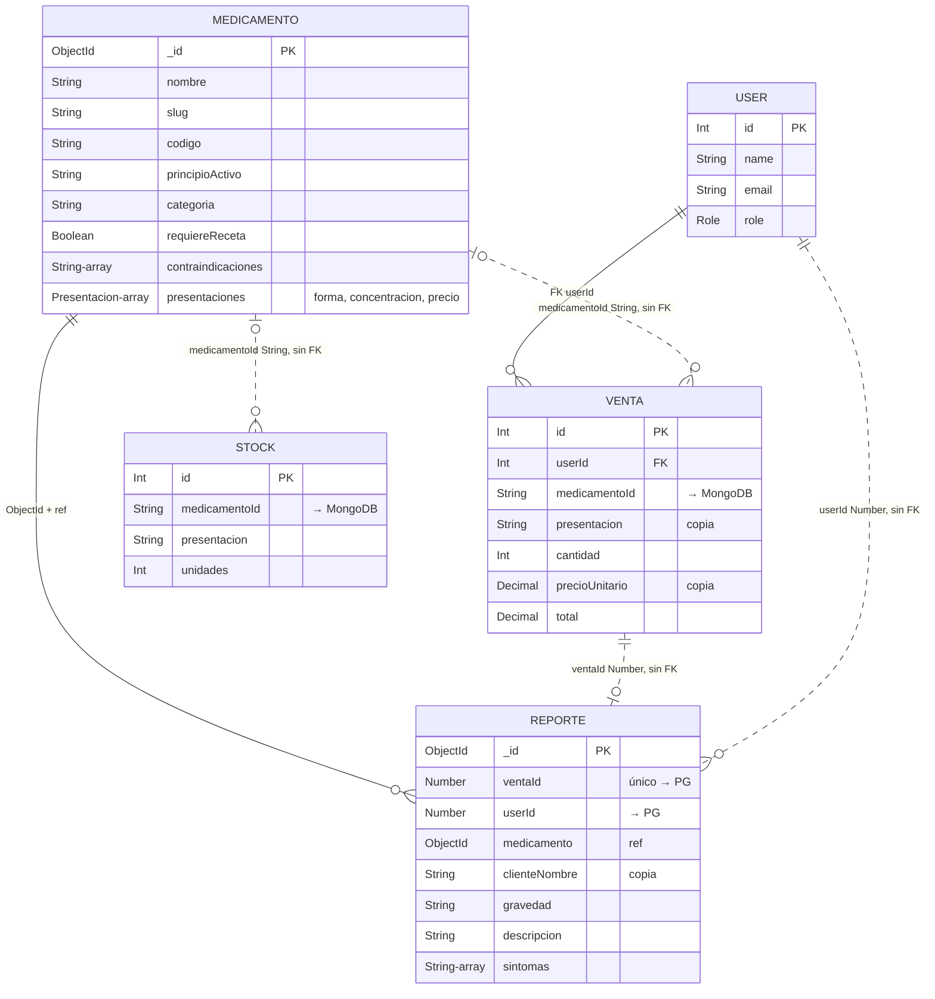

# Tarea individual U2 · Modelo híbrido PostgreSQL + MongoDB

**Estudiante:** María Laura Quiroz Herrera  **N.º de lista:** 12  **Caso:** 12 · Farmacia

## 1. Workload

### 1.1 Casos de uso

- Una farmacia de barrio vende medicamentos a clientes registrados. Cada venta descuenta stock y guarda el total cobrado.
- Los clientes y el personal consultan el catálogo de medicamentos (nombre, principio activo, presentaciones y precios).
- El cliente consulta sus compras con los datos del medicamento.
- Si un cliente tiene una reacción adversa a un medicamento comprado, la reporta (gravedad, síntomas, descripción).
- El farmacéutico mantiene el catálogo, ajusta el stock y revisa los reportes de reacciones por medicamento y gravedad.

### 1.2 Datos principales

- Clientes: ~3 000 (crecen ~60 por mes).
- Medicamentos: ~2 500 en catálogo; cada uno con 1 a 6 presentaciones.
- Ventas: ~400 por día; se conservan 5 años (~730 000).
- Reportes de reacción adversa: ~8 por día (2 % de las ventas). **Crecen sin límite**; se conservan 10 años.
- Stock: una fila por presentación (~6 000 filas), se actualiza en cada venta.

### 1.3 Suposiciones

- Una venta incluye un solo medicamento y una sola presentación (con su cantidad).
- El stock y el total deben ser exactos: no se vende más de lo que hay y el total se calcula en el servidor con el precio vigente.
- El precio cobrado queda guardado en la venta aunque el catálogo cambie después.
- Un medicamento no se elimina mientras tenga ventas.
- Una venta tiene como máximo **un** reporte de reacción adversa.
- El nombre del cliente casi nunca cambia, por eso se puede copiar en el reporte.
- Las presentaciones de un medicamento se leen siempre junto con él y son pocas.

### 1.4 Operaciones

| Actor: | Cliente |
|---|---|
| Descripción: | Compra una presentación de un medicamento |
| Tipo de operación: | Escritura |
| Datos en la operación: | medicamentoId, presentacion, cantidad, userId (del JWT), precioUnitario y total calculados |
| Frecuencia: | ~400 por día, picos entre 17:00 y 19:00 |
| Tasa: | 400 / día |
| Base: | **PostgreSQL** (transacción: descuenta stock y crea la venta de forma atómica); lee MongoDB para validar el medicamento y tomar el precio |

| Actor: | Cliente o farmacéutico |
|---|---|
| Descripción: | Busca medicamentos por nombre o principio activo |
| Tipo de operación: | Lectura |
| Datos en la operación: | nombre, principioActivo, categoria, presentaciones[] |
| Frecuencia: | en cada visita al catálogo |
| Tasa: | ~6 000 / día |
| Base: | **MongoDB** (documento completo con presentaciones embebidas, búsqueda por regex e índice) |

| Actor: | Cliente |
|---|---|
| Descripción: | Consulta sus compras con el nombre y principio activo del medicamento |
| Tipo de operación: | Lectura |
| Datos en la operación: | ventas (PostgreSQL) + nombre, principioActivo, requiereReceta (MongoDB) |
| Frecuencia: | ~1 vez por cliente activo |
| Tasa: | ~800 / día |
| Base: | **Las dos**: se unen en el servicio con `$in` y un `Map` (2 consultas, sin N+1) |

| Actor: | Cliente |
|---|---|
| Descripción: | Reporta una reacción adversa de un medicamento que compró |
| Tipo de operación: | Escritura |
| Datos en la operación: | ventaId, gravedad, descripcion, sintomas[]; userId del JWT; clienteNombre copiado de PostgreSQL |
| Frecuencia: | ~2 % de las ventas |
| Tasa: | ~8 / día (~29 000 en 10 años) |
| Base: | **MongoDB**, colección aparte; lee PostgreSQL para validar la venta y su dueño |

| Actor: | Farmacéutico |
|---|---|
| Descripción: | Actualiza el catálogo (nueva presentación, cambio de precio, contraindicaciones) |
| Tipo de operación: | Escritura |
| Datos en la operación: | nombre, codigo, principioActivo, categoria, presentaciones[], contraindicaciones[] |
| Frecuencia: | pocas veces por semana |
| Tasa: | ~20 / semana |
| Base: | **MongoDB** (forma variable por medicamento, se actualiza el documento completo) |

| Actor: | Farmacéutico |
|---|---|
| Descripción: | Ajusta el stock de una presentación |
| Tipo de operación: | Escritura |
| Datos en la operación: | medicamentoId, presentacion, unidades |
| Frecuencia: | cada recepción de mercadería |
| Tasa: | ~30 / día |
| Base: | **PostgreSQL** (el stock debe ser exacto); lee MongoDB para validar que la presentación exista |

| Actor: | Farmacéutico |
|---|---|
| Descripción: | Revisa los reportes de reacciones por medicamento, ordenados por fecha, con el conteo por gravedad |
| Tipo de operación: | Lectura |
| Datos en la operación: | reportes + nombre del medicamento (populate) + conteo por gravedad (aggregate) |
| Frecuencia: | ~20 veces por día |
| Tasa: | ~20 / día |
| Base: | **MongoDB** (colección que crece; aggregate sobre ella) |

| Actor: | Cliente |
|---|---|
| Descripción: | Anula una venta propia |
| Tipo de operación: | Escritura |
| Datos en la operación: | ventaId; devuelve unidades al stock y elimina el reporte asociado |
| Frecuencia: | ~2 % de las ventas |
| Tasa: | ~8 / día |
| Base: | **Las dos**: PostgreSQL en una transacción y luego limpieza de reportes en MongoDB |

### 1.5 Entidades

- **PostgreSQL**
  - User (cliente o administrador, del login).
  - Venta: userId, medicamentoId, presentacion, cantidad, precioUnitario, total, createdAt.
  - Stock: medicamentoId, presentacion, unidades (único por medicamento y presentación).
- **MongoDB**
  - Medicamento: nombre, slug, codigo, principioActivo, categoria, requiereReceta, contraindicaciones[], presentaciones[] (forma, concentracion, precio).
  - Reporte: ventaId, userId, medicamento, clienteNombre, gravedad, descripcion, sintomas[].
- **Entre bases (sin FK)**
  - Venta.medicamentoId y Stock.medicamentoId apuntan a Medicamento._id.
  - Reporte.ventaId y Reporte.userId apuntan a Venta.id y User.id.

### 1.6 Observaciones

- La lectura del catálogo domina sobre la escritura: ~6 000 consultas frente a ~20 cambios por semana.
- Los reportes de reacción adversa crecen sin límite y se consultan aparte del medicamento.
- Ventas y stock necesitan integridad: stock exacto, total exacto y relación con el usuario por clave foránea.
- Las presentaciones tienen forma variable (forma, concentración y precio distintos por medicamento).

## 2. ¿PostgreSQL o MongoDB?

| Entidad | ¿Transacciones o choques? | ¿Otras dependen por FK? | ¿Forma variable? | ¿Crece sin límite? | ¿Se lee mucho más? | Base |
|---|---|---|---|---|---|---|
| Venta | Sí: descuenta stock y cobra un total exacto | Sí: FK a User | No | Sí, pero acotada por años y por usuario | No | PostgreSQL |
| Stock | Sí: dos ventas a la vez no pueden pasar del stock | No | No | No | No | PostgreSQL |
| Medicamento | No | No (las otras bases lo referencian sin FK) | Sí: presentaciones y contraindicaciones distintas | No | Sí: ~6 000 lecturas frente a ~20 escrituras por semana | MongoDB |
| Reporte de reacción adversa | No | No | Sí: síntomas variables | Sí, sin límite | No | MongoDB |

## 3. Relaciones dentro de MongoDB: embeber o referenciar

| Relación | Cardinalidad | ¿Se lee junto? | ¿Cambia seguido? | ¿Crece sin límite? | Decisión |
|---|---|---|---|---|---|
| Medicamento → presentaciones | 1:pocas (1 a 6) | Sí, siempre con el medicamento | No | No | **Embeber** (`presentaciones[]`) |
| Medicamento → contraindicaciones | 1:pocas | Sí | No | No | **Embeber** (arreglo de String) |
| Medicamento → reportes | 1:muchos | No, se consultan por separado | Sí, se agregan a diario | Sí | **Referenciar** (`Reporte.medicamento` ObjectId con `ref`) |

## 4. ERD híbrido

Zona PostgreSQL: USER, VENTA y STOCK. Zona MongoDB: MEDICAMENTO y REPORTE. Las líneas punteadas cruzan de una base a otra.

## 5. Referencias

| Referencia | Se guarda como | La garantiza | Se une con |
|---|---|---|---|
| Venta.userId → User | Int con FK | PostgreSQL | `include` de Prisma |
| Venta.medicamentoId → Medicamento | `String?` con `@@index` | El servicio: `esObjectId` + `findById` al crear (400/404) y conteo de ventas al borrar el medicamento (409) | `Medicamento.find({ _id: { $in } })` + `Map` |
| Stock.medicamentoId + presentacion → Medicamento | `String` con único compuesto | El servicio: valida el medicamento y la presentación al definir el stock; el borrado del medicamento elimina su stock | Consulta directa por `medicamentoId` |
| Reporte.ventaId → Venta | `Number` con índice único | El servicio: `findUnique` de Prisma al crear (404 si no existe); índice único (409 por E11000) | `prisma.venta.findUnique` |
| Reporte.userId → User | `Number` tomado del JWT | El JWT y la verificación `venta.userId === user.id` (403) | Sin unión: llega en el token |
| Reporte.medicamento → Medicamento | `ObjectId` con `ref` | Mongoose: el id sale de la venta ya validada | `populate("medicamento")` |

## 6. Dato copiado entre bases (desnormalización)

- **PostgreSQL → MongoDB: `clienteNombre`** en el reporte.
  - Por qué: el farmacéutico revisa reportes sin consultar PostgreSQL por cada uno.
  - Costo: si el cliente cambia su nombre, los reportes viejos conservan el anterior.
- **MongoDB → PostgreSQL: `precioUnitario` y `presentacion`** en la venta.
  - Por qué: el total debe ser exacto y el historial de ventas no puede cambiar cuando el catálogo cambia de precio.
  - Costo: el precio de la venta puede diferir del precio actual del catálogo, y es el comportamiento buscado.

## 7. Endpoints

| Método y ruta | Base(s) | Respuestas posibles |
|---|---|---|
| POST /api/auth/register | PostgreSQL | 201, 400, 409 |
| POST /api/auth/login | PostgreSQL | 200, 400, 401 |
| POST /api/medicamentos (JWT) | MongoDB | 201, 400, 401 |
| GET /api/medicamentos?q=&fields=&sort=&categoria= | MongoDB | 200 |
| GET /api/medicamentos/:id | MongoDB | 200, 400, 404 |
| PUT /api/medicamentos/:id (JWT) | MongoDB | 200, 400, 401, 404 |
| DELETE /api/medicamentos/:id (JWT) | Las dos | 204, 400, 401, 404, 409 |
| PUT /api/stock (JWT) | PostgreSQL + MongoDB | 200, 400, 401, 404 |
| GET /api/stock/:medicamentoId (JWT) | PostgreSQL + MongoDB | 200, 400, 401, 404 |
| POST /api/ventas (JWT) | PostgreSQL + MongoDB | 201, 400, 401, 404, 409 |
| GET /api/ventas (JWT) | PostgreSQL + MongoDB (`$in` + `Map`) | 200, 401 |
| DELETE /api/ventas/:id (JWT) | Las dos | 204, 400, 401, 403, 404 |
| POST /api/reportes (JWT) | MongoDB + PostgreSQL | 201, 400, 401, 403, 404, 409 |
| GET /api/reportes?medicamento=&gravedad=&sort= (JWT) | MongoDB (populate + aggregate) | 200, 400, 401 |

## 8. Qué pasa si una base falla a la mitad

- **Crear venta:** MongoDB solo se lee antes de la transacción. Si falla, no se escribe nada. Si PostgreSQL falla dentro de la transacción, el descuento de stock y la venta se revierten juntos.
- **Crear reporte:** primero se lee PostgreSQL y después se escribe en MongoDB. Si MongoDB falla, no queda nada guardado y el cliente repite la petición.
- **Anular venta:** se confirma primero en PostgreSQL (fuente de verdad) y luego se borran los reportes en MongoDB. Si MongoDB falla en ese paso, queda un reporte huérfano que se limpia repitiendo el borrado de reportes por `ventaId`.
- **Eliminar medicamento:** se borran reportes y stock antes del documento. Si algo falla en el camino, el medicamento sigue existiendo y la operación se puede repetir.
